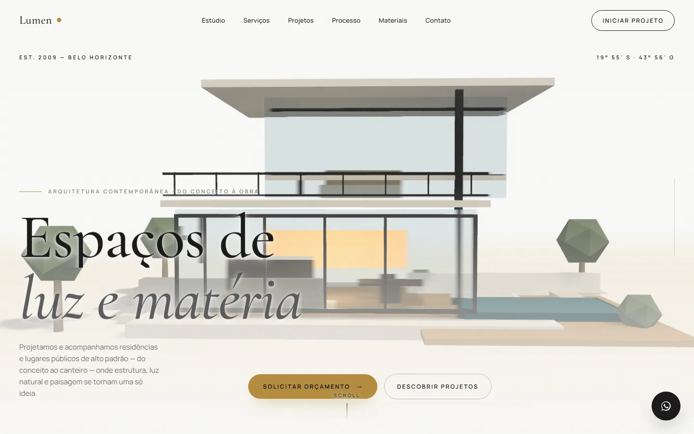
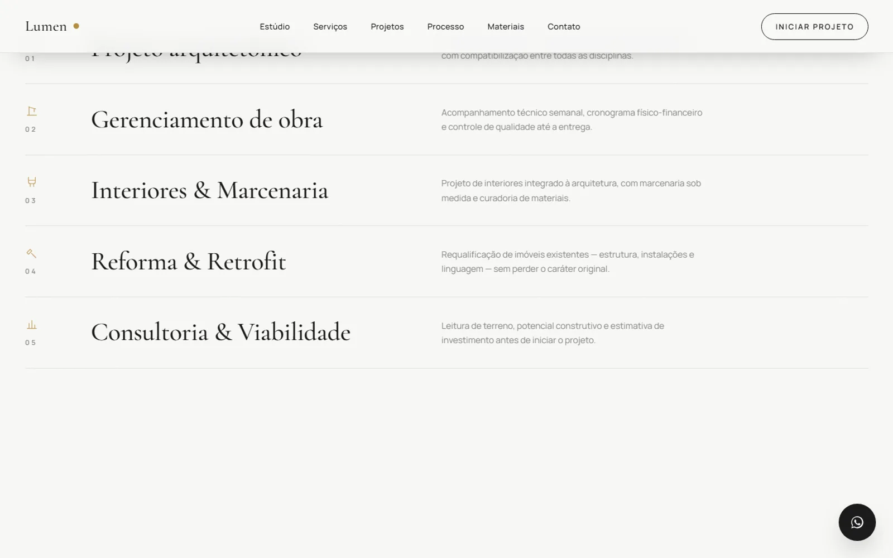

**English** | [Português](README.pt-BR.md)

# Lumen Architecture

Website for a **fictional** architecture studio, built as a MilWeb portfolio piece. The brand, projects, statistics, testimonials and contact details are illustrative (e-mail on an `.example` domain, invalid phone and WhatsApp numbers); photos come from Unsplash. The site copy is in Portuguese.

> **Type:** commercial demo / portfolio (fictional brand) · **Demo:** https://lumen-architecture-drab.vercel.app



## Features

- Single page with a code-generated 3D house (no external model) where the camera moves through the rooms as you scroll.
- Second, interactive 3D scene: drag to rotate, zoom and pick a room (living room, bedroom, kitchen, pool).
- Studio, services, projects (with modal and gallery), process, materials, animated stats, testimonials and contact sections.
- 3D scenes are lazy-loaded, fall back to a static image when WebGL fails, and use adaptive DPR based on performance.
- Camera honours `prefers-reduced-motion`; smooth scrolling with Lenis; preloader, custom cursor and WhatsApp button.
- Contact form is visual only (no backend: it just shows the sending feedback).
- SEO metadata and JSON-LD via `react-helmet-async`.



## Stack

- Vite 6, React 19, TypeScript 5
- three, @react-three/fiber, @react-three/drei and @react-three/postprocessing
- GSAP (ScrollTrigger), Framer Motion and Lenis
- SCSS Modules (no Tailwind)
- react-helmet-async (metadata)
- Vitest + Testing Library (unit) and Playwright (e2e smoke)
- ESLint and Prettier

## Getting started

Requirements: Node.js 22 (used in CI) and npm. The repository `.npmrc` enables `legacy-peer-deps`, which is needed to install the dependencies with React 19.

```bash
npm ci
npm run dev         # http://localhost:5173
```

No environment variables are used.

## Scripts

| Script | What it does |
| --- | --- |
| `npm run dev` | Vite dev server |
| `npm run build` | typecheck (`tsc -b`) + production build into `dist/` |
| `npm run preview` | serves the build |
| `npm run lint` | ESLint |
| `npm run typecheck` | `tsc -b --noEmit` |
| `npm test` | Vitest |
| `npm run e2e` | Playwright (builds and starts the preview on port 4173; requires Playwright browsers installed) |
| `npm run format` / `format:check` | Prettier |

## Structure

```
src/
  sections/    page sections (Hero, About, Services, Projects, ...)
  components/  navbar, cursor, preloader, modal, buttons and animations
  three/       3D scenes (procedural house, camera, lights, interactive scene)
  hooks/       Lenis, viewport, adaptive DPR, reduced motion
  constants/   site content (fictional)
  styles/      SCSS tokens and global styles
public/models/ instructions for swapping the procedural house for a .glb
e2e/           Playwright tests
```

## Limitations

- No backend: the contact form does not send data.
- Content is hard-coded in `src/constants/site.ts` and only in Portuguese.
- The 3D chunks exceed 500 kB minified (Vite warning during build).
- `npm run format:check` reports files that do not follow the Prettier style (pre-existing).

## Credits

Photos: Unsplash (loaded by URL from `images.unsplash.com`). Fonts: Cormorant Garamond and Manrope via Google Fonts. The 3D house is modelled in code within this project.

## Security

See [SECURITY.md](SECURITY.md).

## License

No license has been chosen yet; all rights reserved by the author.
